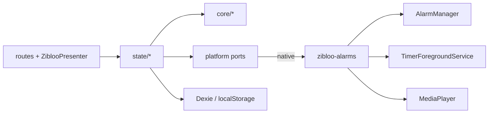
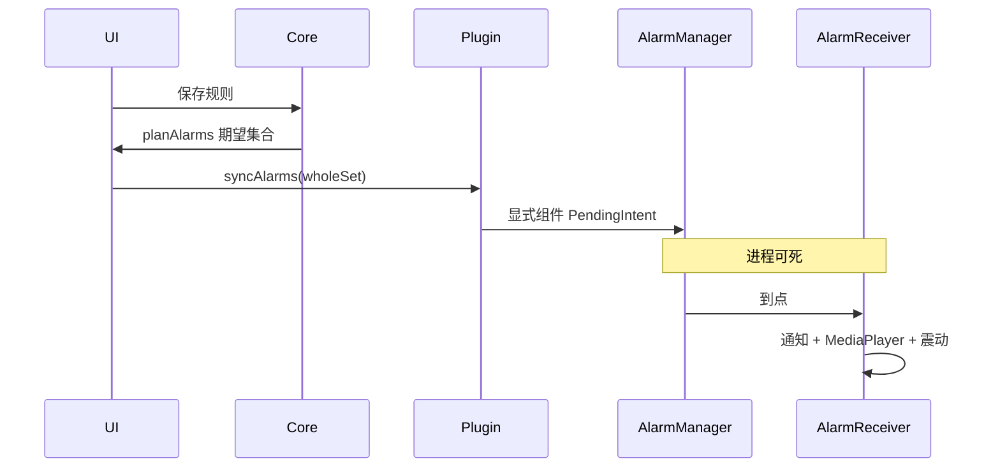

# Zibloo 架构(当前实现)

本文描述仓库里现在有什么。产品意图见 [`intent.md`](intent.md)。选型见 [0001](decisions/0001-sveltekit-capacitor-kotlin-alarms.md)。核对日期:2026-10-30。

## 栈

| 层 | 实际选择 | 证据 |
|---|---|---|
| UI | Svelte 5 + SvelteKit,`@sveltejs/adapter-static` 配在 `vite.config.ts` | `package.json`、`src/routes/` |
| 壳 | Capacitor 8,仅 Android,`appId` `io.zibloo.app` | `capacitor.config.ts`、`android/` |
| 原生 | `zibloo-alarms` Kotlin 插件 | `android/app/src/main/java/io/zibloo/app/` |
| SDK | min 24,compile / target 36 | `android/variables.gradle` |
| 持久化 | Dexie 存历史与提醒;localStorage 存设置与训练预设;SharedPreferences 镜像闹钟 | `src/persistence/db.ts`、`src/state/settings.svelte.ts`、`src/state/presets.svelte.ts`、`ReminderStore.kt` |
| 测试 | Vitest + fast-check;网页 Playwright 冒烟;模拟器 CI;真机清单 | `src/**/*.test.ts`、`scripts/smoke.mjs`、`.github/workflows/` |

网页版与 App 同源静态站点。网页不承诺杀进程 / 重启后的提醒。

## 不变式

1. **时间戳即真值**:剩余时间是 `f(锚点, now)`,不写入存储。`projectSession` 一次可跨任意多段。
2. **规则表为唯一事实源**:`planAlarms` 算出期望集合,`AlarmPort.syncAlarms` 全量替换;不一致时以规则表重建。
3. **Zibloo 呈现无状态**:`mapZibloo` 是唯一映射实现;前台与通知文案键共用 `ZiblooPresentation`。
4. **原生层只收绝对时刻**:不理解规则语义,不感知语言。
5. **解锁只增不减**:`overlay` 首版恒空;断用回落靠不传 overlay,不删数据。

## 模块地图

依赖单向:`routes` / `zibloo` → `state` → `core`。`core` 不依赖 svelte / dexie / capacitor。`src/core/arch.test.ts` 与 `src/arch-boundary.test.ts` 扫描源码强制该边界。

```text
src/
├─ core/                 纯 TypeScript
│  ├─ timer/             engine.ts types.ts presets.ts
│  ├─ reminders/         rule.ts plan.ts
│  ├─ zibloo/            mapping.ts cues.ts
│  ├─ history/           history.ts
│  ├─ data/              transfer.ts 备份信封
│  └─ tz.ts
├─ state/                Svelte 5 runes;副作用编排
├─ platform/             AlarmPort / AudioPort / ForegroundPort
│  ├─ capacitor/         插件封装
│  └─ web/               页面存活期内的降级
├─ persistence/          Dexie 仓库,不上抛给 UI
├─ i18n/                 messages.ts
├─ zibloo/               ZiblooPresenter.svelte
└─ routes/               小窝 / training / focus / reminders / run / history / settings
```



## 计时

`TimerPlan` 为 `training | focus | quick`。`expandSegments` 一次性展开绝对段;暂停只写 `pausedAt`,恢复把暂停锚点之后的段平移。`planSessionAlarms` 产出段边界绝对时刻,经 `syncTimerAlarms` 投影到原生,App 被杀时仍能在段边界发声。

运行页读写 `src/state/timer.svelte.ts`。快捷计时从主页直接 `startSession('quick', …)`。

## 提醒

`ReminderRule`:`once | daily | weekly | interval`。`nextTrigger` 用规则内的本地时刻,时区在 `core/tz.ts` 处理。UI 可新建、开关、删除;没有编辑已有规则的表单。

精确闹钟被拒时 `syncAlarms` 返回 `degraded`,提醒页顶部警告并引导系统设置。降级到 `setAndAllowWhileIdle`。

## 可靠性链路



- V1:倒计时纯推导;运行中 `TimerForegroundService` 保活与常驻通知,不 tick。
- V2:提醒走 `AlarmManager`;`AlarmReceiver` 不依赖 WebView。PendingIntent 必须指向显式组件(隐式 action+package 会在入队时被丢弃)。`targetSdk` 34+ 动态注册 receiver 必须 `RECEIVER_NOT_EXPORTED`。
- V3:`BootReceiver` 监听 `BOOT_COMPLETED` 与 `MY_PACKAGE_REPLACED`,从 `ReminderStore` 镜像重建。冷启动再 `syncAlarms` 一次。

模拟器 CI(`.github/workflows/android-emulator.yml`)覆盖杀进程触发与重启重建。真机仍须走 runbook。

## 角色渲染

`mapZibloo`(`src/core/zibloo/mapping.ts`)按优先级:召唤 > 庆祝 > 打招呼 > 运行中 > 待机。`ZiblooPresenter` 只吃 `ZiblooPresentation`,循环 `static/zibloo/frames/stroke-*.png`,招呼用 `greet.png`。无点击游动、无方向键。

## 数据

| 数据 | 存储 | 备份 |
|---|---|---|
| 历史、提醒 | Dexie `zibloo`,schema v3(外置 UUID 主键;v1 自增主键已废弃) | `core/data/transfer.ts` 信封 `zibloo-backup` v1 |
| 训练预设、语言 / 声音 | localStorage | 预设进备份;设置不进备份 |
| 闹钟载荷镜像 | SharedPreferences | 每次 `syncAlarms` 与规则表收敛 |

导入是破坏性覆盖,UI 必须确认。版本或 `kind` 不匹配则拒绝。

## 声音与 i18n

Cue:`work | rest | complete | greet | reminder`。Web 播 `static/sounds/<voice>/<cue>.wav`;Android 播 `res/raw/<voice>_<cue>.wav`。`en` 使用 `satisfies Messages`,漏 key 编译失败。

## 测试与 CI

| 检查 | 位置 |
|---|---|
| 计时 / 提醒 / 映射 / 备份 / 分层 | `src/core/**/*.test.ts`、`src/arch-boundary.test.ts` |
| 网页冒烟 | `scripts/smoke.mjs` ← `.github/workflows/ci.yml` |
| debug APK | `.github/workflows/android.yml` |
| 模拟器可靠性 | `.github/workflows/android-emulator.yml` + `scripts/device-smoke.mjs` |
| 真机 V1–V3 | [`runbooks/device-acceptance.md`](runbooks/device-acceptance.md),尚未记录结果 |

默认分支 `codex/prototype-b2-c3`。无 Issue / Release。

## 演进落点

新计时模式加 `TimerPlan` 分支;新提醒加 `ReminderRule` 分支;新平台实现 `platform/ports`;新姿态只改 `ZiblooPresentation` 与 Presenter。Dexie 主键不可原地改,走删表重建。不为假想模式预建插件系统。
