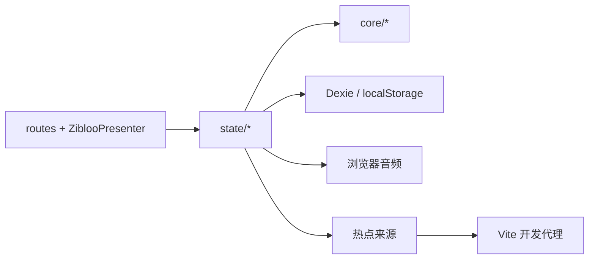

# Zibloo 架构(当前实现)

本文描述仓库里的网页端实现。产品范围见 [`intent.md`](intent.md),平台决策见 [0009](decisions/0009-web-only.md)。核对日期:2026-11-04。

## 栈

| 层 | 实际选择 | 证据 |
|---|---|---|
| UI | Svelte 5 + SvelteKit,静态适配器 | `package.json`、`src/routes/`、`vite.config.ts` |
| 运行端 | 浏览器网页;当前只维护网页端 | `src/platform/web/`、[决策 0009](decisions/0009-web-only.md) |
| 持久化 | Dexie 存计时历史;localStorage 存设置、训练预设、热点缓存、钉选项和进行中的计时 | `src/persistence/db.ts`、`src/state/` |
| 验证 | Vitest + fast-check;Playwright 网页冒烟;GitHub Actions 网页 CI | `src/**/*.test.ts`、`scripts/smoke.mjs`、`.github/workflows/ci.yml` |

当前无原生外壳、服务端账号或应用商店发布目标。

## 不变式

1. **时间戳即真值**:剩余时间由锚点和当前时间推导,不写入存储。`projectSession` 一次可跨任意多段。
2. **浏览器负责页面内副作用**:状态层调用网页音频;计时依赖页面运行,浏览器可能降低后台计时精度,关页后不会触发提示。
3. **Zibloo 呈现无状态**:`mapZibloo` 是角色动作、提示音和粒子的唯一映射实现。
4. **核心保持纯 TypeScript**:`core` 不依赖 Svelte、Dexie、浏览器或网络请求实现。

## 模块地图

依赖单向:`routes` / `zibloo` → `state` → `core`。`core` 不依赖 UI、持久化或浏览器能力。

```text
src/
├─ core/                 纯 TypeScript
│  ├─ timer/             engine.ts types.ts presets.ts
│  ├─ board/             计时会话还原
│  ├─ trending/          榜单解析与合并,不发请求
│  ├─ zibloo/            mapping.ts cues.ts
│  ├─ history/           history.ts
│  ├─ data/              transfer.ts 备份信封
│  └─ tz.ts
├─ state/                Svelte 5 runes;副作用编排
│  ├─ board.svelte.ts    热点缓存、收取
│  ├─ runs.svelte.ts     看板上的多张计时
│  ├─ timer.svelte.ts    /run 单会话
│  ├─ presets.svelte.ts
│  └─ settings.svelte.ts
├─ platform/web/         浏览器音频与热点请求
├─ persistence/          Dexie 仓库
├─ i18n/                 messages.ts
├─ zibloo/               ZiblooPresenter.svelte
└─ routes/               看板 / run
```



## 看板与热点

主页 `src/routes/+page.svelte` 是一块按来源纵向分组的大看板。训练、专注和快捷计时放在「计时」块。热点卡片支持笔记和打开来源;顶栏提供搜索与手动收取。

`src/state/board.svelte.ts` 并行请求 `core/trending/sources.ts` 的十个来源。开发时 `fetchText` 通过 Vite 的 `/api/fetch` 代理;静态网页生产环境直接请求来源,因此部分来源会被浏览器 CORS 策略拦截。单个来源失败不影响其他来源。热点合并保留首次出现时间和笔记,缓存写入 localStorage。

## 计时

`TimerPlan` 为 `training | focus | quick`。`expandSegments` 把计划展开为绝对时间段;暂停时记录锚点,恢复时平移尚未完成的段。剩余时间始终由 `projectSession(session, now)` 计算。

看板的 `src/state/runs.svelte.ts` 为每张计时卡保存一份会话,因此可以同时运行多张。页面计时器每 250 毫秒刷新当前时间;自然完成或用户结束后写入 Dexie 历史。`/run` 与 `src/state/timer.svelte.ts` 保留单会话网页路径。两条路径的提示音都只在页面可见时播放;后台计时可能受浏览器节流,关闭页面后不会继续触发提示。

## 角色与声音

`mapZibloo`(`src/core/zibloo/mapping.ts`)按优先级映射庆祝、招呼、运行中和待机状态。`ZiblooPresenter` 根据 `ZiblooPresentation` 显示角色姿态。浏览器音频由 `src/platform/web/audio.ts` 播放 `static/sounds/<voice>/<cue>.wav`;首次用户交互会解锁自动播放限制。`en` 使用 `satisfies Messages`,漏 key 会在类型检查时报错。

## 数据

| 数据 | 存储 | 备份 |
|---|---|---|
| 历史 | Dexie `zibloo`,schema v4 | `core/data/transfer.ts` 的 `zibloo-backup` v1 信封 |
| 训练预设、语言 / 声音 | localStorage | 预设进备份;设置不进备份 |
| 热点、钉选项、进行中的看板计时 | localStorage | 不进备份 |

当前没有备份导入/导出 UI。若将来恢复导入界面,覆盖现有历史与预设前必须先确认。解析器拒绝版本或 `kind` 不匹配的文件,并忽略旧备份中的 `reminders` 字段。

## 网页 CI

| 检查 | 位置 |
|---|---|
| 计时 / 榜单 / 角色映射 / 备份 / 分层 | `src/**/*.test.ts`、`src/arch-boundary.test.ts` |
| 类型检查、单元测试、静态构建 | `.github/workflows/ci.yml` 的 `test-and-build` |
| Playwright 网页冒烟 | `scripts/smoke.mjs`、同工作流的 `web-smoke` |

默认分支 `main`。当前不构建或保存 APK/模拟器产物。

## 演进落点

新计时模式加 `TimerPlan` 分支;新热点来源加 `Platform`、`SOURCES` 与 `PARSERS`;新角色姿态只改 `ZiblooPresentation` 与 Presenter。其他运行端开发暂停;如需恢复,先更新 [决策 0009](decisions/0009-web-only.md) 与产品意图。
