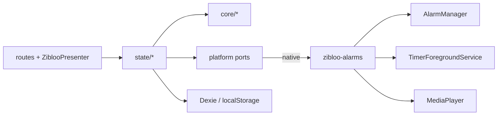
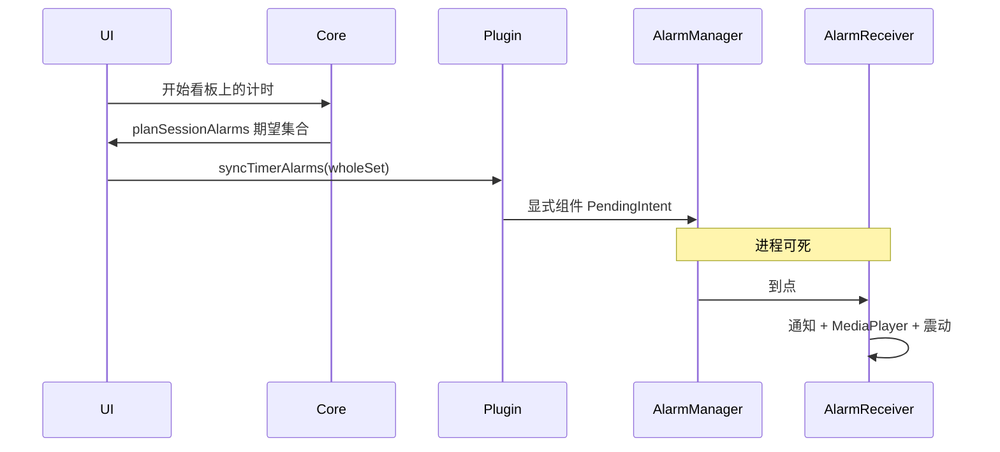

# Zibloo 架构(当前实现)

本文描述仓库里现在有什么。产品意图见 [`intent.md`](intent.md)。选型见 [0001](decisions/0001-sveltekit-capacitor-kotlin-alarms.md)。核对日期:2026-11-03。

## 栈

| 层 | 实际选择 | 证据 |
|---|---|---|
| UI | Svelte 5 + SvelteKit,`@sveltejs/adapter-static` 配在 `vite.config.ts` | `package.json`、`src/routes/` |
| 壳 | Capacitor 8,仅 Android,`appId` `io.zibloo.app` | `capacitor.config.ts`、`android/` |
| 原生 | `zibloo-alarms` Kotlin 插件 | `android/app/src/main/java/io/zibloo/app/` |
| SDK | min 24,compile / target 36 | `android/variables.gradle` |
| 持久化 | Dexie 存计时历史;localStorage 存设置、训练预设、热点缓存与进行中的计时;SharedPreferences 镜像闹钟 | `src/persistence/db.ts`、`src/state/settings.svelte.ts`、`src/state/presets.svelte.ts`、`src/state/board.svelte.ts`、`src/state/runs.svelte.ts`、`ReminderStore.kt` |
| 测试 | Vitest + fast-check;网页 Playwright 冒烟;模拟器 CI;真机清单 | `src/**/*.test.ts`、`scripts/smoke.mjs`、`.github/workflows/` |

网页版与 App 同源静态站点。网页不承诺杀进程 / 重启后的计时闹钟。

## 不变式

1. **时间戳即真值**:剩余时间是 `f(锚点, now)`,不写入存储。`projectSession` 一次可跨任意多段。
2. **原生计时闹钟是段边界投影**:`planSessionAlarms` 算出期望集合,`AlarmPort.syncTimerAlarms` 全量替换。重启不重建计时域;冷启动 `loadRuns` 后再同步。
3. **Zibloo 呈现无状态**:`mapZibloo` 是唯一映射实现;前台与通知文案键共用 `ZiblooPresentation`。
4. **原生层只收绝对时刻**:不理解规则语义,不感知语言。
5. **解锁只增不减**:`overlay` 首版恒空;断用回落靠不传 overlay,不删数据。

## 模块地图

依赖单向:`routes` / `zibloo` → `state` → `core`。`core` 不依赖 svelte / dexie / capacitor。`src/core/arch.test.ts` 与 `src/arch-boundary.test.ts` 扫描源码强制该边界。

```text
src/
├─ core/                 纯 TypeScript
│  ├─ timer/             engine.ts types.ts presets.ts
│  ├─ board/             计时会话还原
│  ├─ trending/          榜单解析与合并,不发请求
│  ├─ zibloo/            mapping.ts cues.ts
│  ├─ history/           history.ts
│  ├─ data/              transfer.ts 备份信封
│  └─ tz.ts
├─ state/                Svelte 5 runes;副作用编排
│  ├─ board.svelte.ts    热点缓存、收取
│  ├─ runs.svelte.ts     看板上的多张计时,独占新路径的计时闹钟
│  ├─ timer.svelte.ts    旧运行页的单会话
│  ├─ presets.svelte.ts
│  └─ settings.svelte.ts
├─ platform/             AlarmPort / AudioPort / ForegroundPort / fetchText
│  ├─ capacitor/         插件封装
│  └─ web/               页面存活期内的降级;http.ts 取热点原文
├─ persistence/          Dexie 仓库,不上抛给 UI
├─ i18n/                 messages.ts
├─ zibloo/               ZiblooPresenter.svelte(stage / companion)
└─ routes/               看板 / run(旧运行页残留)
```



## 看板

主页 `src/routes/+page.svelte` 是一块大看板。没有侧栏。热点按 `PLATFORMS` 顺序分块(GitHub、HN、Lobsters 等),每块标题加卡片网格,整页一起滚。训练、专注、快捷计时在「计时」块。

卡片来自热点缓存、内置训练模板、训练预设、专注时长、快捷分钟,以及已钉上的计划(`zibloo.board.pinned.v1`)。`digestTrends` 仍在 `core/trending`,这版 UI 不用。

收取并行请求 `core/trending/sources.ts` 的十个地址,始终拉全部来源。解析在 `core/trending/parse.ts`,合并在 `mergeTrends`(保留 `firstSeen` 和笔记,未见条目留在缓存,最多 400 条),写入 `zibloo.board.trends.v1`。GitHub 空榜或失败时再拉 gitstock。卡片带热度、语言、连续在榜天数;点开抽屉写笔记。顶栏有搜索。开发时 `fetchText` 走 Vite 的 `GET /api/fetch?url=`。安卓打开 `plugins.CapacitorHttp.enabled`,原生接管 `fetch`。静态网页的生产构建没有这层代理,非 CORS 来源会失败;单源错误不影响其余来源。token、周榜语言分榜、GitHub 仓库补全不在这版。

## 计时

`TimerPlan` 为 `training | focus | quick`。`expandSegments` 一次性展开绝对段;暂停只写 `pausedAt`,恢复把暂停锚点之后的段平移。`planSessionAlarms` 产出段边界绝对时刻,经 `syncTimerAlarms` 投影到原生,App 被杀时仍能在段边界发声。

看板上的开始、暂停、跳过、结束走 `src/state/runs.svelte.ts`。每张卡一份 `Session`,键是 `cardId`,存在 `zibloo.runs.v1`。剩余时间仍是 `projectSession(session, now)`。自然结束或点结束后,卡片留在看板上,完成写入 Dexie 历史。多张未暂停会话的未来段边界拍平后一次 `syncTimerAlarms`;已过去的边界不会重排,避免恢复时立即补响。前台通知跟最近开始的那张;多于一张时正文用 `board.runningMany`。

`/run` 与 `src/state/timer.svelte.ts` 仍是单会话,也会全量替换计时闹钟。训练、专注、快捷都在看板上开始,不进该页。两条路径不要同时计时,后一次同步会盖掉前一次。

提醒产品已下线。布局首次加载会 `syncAlarms([])`,清掉旧安装残留的提醒域闹钟。插件里的提醒域接口仍在,产品不再写入。

## 可靠性链路



这几条是闹钟链路,不是 [`intent.md`](intent.md) 里的产品验收 V1–V5。

- 计时保活:倒计时纯推导;运行中 `TimerForegroundService` 保活与常驻通知,不 tick。看板上多张未暂停会话合并进同一次 `syncTimerAlarms`。
- 计时闹钟:走 `AlarmManager`;`AlarmReceiver` 不依赖 WebView。PendingIntent 必须指向显式组件(隐式 action+package 会在入队时被丢弃)。`targetSdk` 34+ 动态注册 receiver 必须 `RECEIVER_NOT_EXPORTED`。列判断不参与这次同步。
- 开机: `BootReceiver` 监听 `BOOT_COMPLETED` 与 `MY_PACKAGE_REPLACED`,取消两域残留闹钟并清空镜像。冷启动 `loadRuns` 后再 `syncTimerAlarms`。

模拟器 CI(`.github/workflows/android-emulator.yml`)覆盖杀进程后计时完成,以及重启后看板能打开。真机仍须走 runbook。

## 角色渲染

`mapZibloo`(`src/core/zibloo/mapping.ts`)按优先级:庆祝 > 打招呼 > 运行中 > 待机。`ZiblooPresenter` 只吃 `ZiblooPresentation`,循环 `static/zibloo/frames/stroke-*.png`,招呼用 `greet.png`。无点击游动、无方向键。

看板上 `boardPresentation` 把最近开始且仍在走的会话交给映射,Presenter 用 `size="companion"` 画在顶栏。点击仍走 `timer.svelte.ts` 的 `greet`。`/run` 继续用默认 `stage`。

## 数据

| 数据 | 存储 | 备份 |
|---|---|---|
| 历史 | Dexie `zibloo`,schema v4(v3 曾有提醒表,v4 删掉;v1 自增主键已废弃) | `core/data/transfer.ts` 信封 `zibloo-backup` v1 |
| 训练预设、语言 / 声音 | localStorage | 预设进备份;设置不进备份 |
| 热点、钉上的计划、进行中的多段计时 | localStorage `zibloo.board.trends.v1`、`zibloo.board.pinned.v1`、`zibloo.runs.v1` | 不进备份 |
| 闹钟载荷镜像 | SharedPreferences | 每次 `syncTimerAlarms` 与进行中的会话收敛;提醒域启动时清空 |

导入是破坏性覆盖,UI 必须确认。版本或 `kind` 不匹配则拒绝。旧备份若带 `reminders` 字段,解析时忽略。

## 声音与 i18n

Cue:`work | rest | complete | greet | reminder`。`reminder` 叫声文件仍在,产品路径不再播放。Web 播 `static/sounds/<voice>/<cue>.wav`;Android 播 `res/raw/<voice>_<cue>.wav`。`en` 使用 `satisfies Messages`,漏 key 编译失败。

## 测试与 CI

| 检查 | 位置 |
|---|---|
| 计时 / 榜单解析与合并 / 映射 / 备份 / 分层 | `src/core/**/*.test.ts`、`src/arch-boundary.test.ts` |
| 网页冒烟 | `scripts/smoke.mjs` ← `.github/workflows/ci.yml` |
| debug APK | `.github/workflows/android.yml` |
| 模拟器可靠性 | `.github/workflows/android-emulator.yml` + `scripts/device-smoke.mjs` |
| 真机:看板、锁屏计时、杀进程段边界、多卡、收取 | [`runbooks/device-acceptance.md`](runbooks/device-acceptance.md),尚未记录结果 |

默认分支 `main`。无 Issue / Release。

## 演进落点

新计时模式加 `TimerPlan` 分支;新热点来源加 `Platform`、`SOURCES` 与 `PARSERS`。新平台实现 `platform/ports`;新姿态只改 `ZiblooPresentation` 与 Presenter。Dexie 主键不可原地改,走删表重建。不为假想模式预建插件系统。
